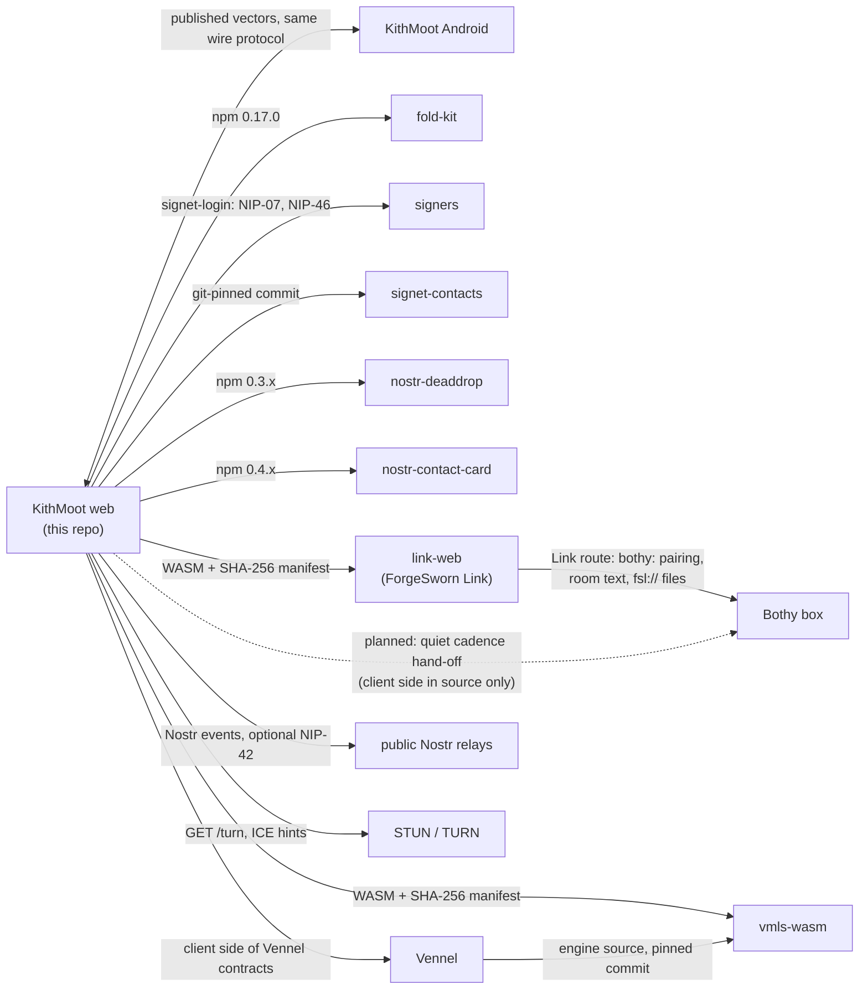

# Where KithMoot fits

KithMoot is an open workspace on Nostr: rooms, chat, files, calls and agents as members. This repository is the TypeScript reference client and headless library: the room protocol in `src/`, the PWA in `app/`, the desktop client in `desktop/`, and the shared test vectors in `vectors/`. It depends on a few neighbouring projects and talks to a few services. This page lists the direct neighbours and the exact interface to each; each neighbour's own repository is the authority for its side. For the protocol itself, read [the M2 draft](protocol.md) and [the security model](security-model.md).

| Neighbour | Relationship | Interface | Status |
| --- | --- | --- | --- |
| `@forgesworn/fold-kit` | Holds the circle layer: identity, credentials, rooms, links, invitations, epochs, channel derivation, lane. Files such as `src/identity.ts`, `room.ts` and `link.ts` are re-export shims. | npm `@forgesworn/fold-kit` 0.17.0. Changes land there first; this repo then bumps the pin. | Built |
| ForgeSworn Link (`link-web`) | The browser carrier to a paired Bothy. Settings → Bothy connection pairs a `bothy:` code; pairing alone changes no room's transport. | WASM and JS in `app/public/link-web/`, built from a pinned Link commit. `manifest.json` records the commit and a SHA-256 per file; `npm run build` verifies them (`scripts/check-link-web.mjs`). Served from this app's origin, loaded only on connection, kept out of service-worker precaching. See [browser-link.md](browser-link.md). | Built, limited scope: ordinary main-chat text, presence and control before the first rekey. No calls, new invitations or quiet rooms. Desktop Chromium lab evidence only |
| Bothy: room routing | A paired box carries a room's main-chat text after explicit grants. | "Bothy room routing" in the room menu: the keeper grants the listed current devices and each participant selects their own paired route. Consent and grants live in encrypted IndexedDB. See [browser-room-activation.md](browser-room-activation.md). | Built, same limited scope. The Link relay sees network addresses, timing and volume |
| Bothy: encrypted files | Opt-in private file storage on the paired box. | A message carries a Link `fsl://node/hash` reference; the file key travels inside the room's encrypted content. Ciphertext cap 64 MiB including encryption and padding. Needs a NIP-07 signer and a Full pairing per recipient. See [private-bothy-files.md](private-bothy-files.md). | Built. Fixture-based browser acceptance only; no physical-device or Android acceptance |
| Bothy: status and cadence | Opt-in check of a contact's box; the phone-owned half of quiet cadence hand-off. | Discovery reads the keeper claim (kind 30640) and box status (kind 10640) from the configured read relays and verifies them offline (`src/box-status.ts`, [box-discovery.md](box-discovery.md)). Cadence builds NIP-98 (kind 27235) control bodies for a Link session (`src/box-cadence.ts`, [quiet-cadence-box-client.md](quiet-cadence-box-client.md)). | Discovery built, per contact box, not yet run against a running Bothy on owned devices. Cadence in source only, not in the product |
| Vennel | KithMoot implements the client side of Vennel's contracts: MLS and restore witness, the G5 Bothy fixture used for acceptance runs, the G7 cadence contract, rendezvous provisioning. | Shared vectors (`vectors/bothy-issued-discovery.json`, `vectors/cadence-v1.json`, `vectors/vmls/`) and the `vmls-wasm` pin below. Vennel's repository is private, so these docs cite its commits and do not link to it. | Development only. Production MLS is unavailable |
| `vmls-wasm` | Vennel's MLS engine compiled to WASM, for the development-only browser MLS preview. | `app/public/vmls-wasm/` (plus invitation-profile variants). `manifest.json` records the source commit, Rust 1.94.1, wasm-bindgen 0.2.129 and a SHA-256 per file; `scripts/check-vmls-wasm.mjs` verifies them. Loaded explicitly, kept out of precaching. See [browser-mls-integration.md](browser-mls-integration.md). | Preview behind explicit development switches |
| Signers (`signet-login`) | Supplies the sign-in picker. The signed-in key becomes the participant key and signs one thing per room: the device credential. | npm `signet-login` 0.21.0: NIP-07 extensions, NIP-46 / NostrConnect, bunker URIs, Amber on Android. Anything with a pubkey and an async `signEvent` satisfies `ParticipantIdentity`. A pasted `nsec` or `ncryptsec` stays in page memory. See [nostr-identity.md](nostr-identity.md). | Built |
| `@forgesworn/signet-contacts` | Reads the contact directory a Signet account explicitly grants (tiers, checks, blocks) and runs the spoken-words channel check between two people. | Git-pinned commit in `package.json`. Used in `app/src/granted-contacts.ts` (`parseProjection`) and `app/src/channel-checks.ts` (room channel `signet-checks-v1`). See [signet-contact-messaging.md](signet-contact-messaging.md). | Built |
| `nostr-deaddrop` | Carries quiet rooms; derives the public drop keys for a box cadence lease. | npm `nostr-deaddrop` 0.3.x: `QuietTransport` in `src/quiet.ts` (kind 1059 gift wraps to epoch-derived keys), `deriveRoomDropKey` in `src/box-cadence.ts`. | Quiet rooms built; box cadence as above |
| `nostr-contact-card` | Reads contact cards: a person's key, relays and endorsed boxes, with the Link address card verified and the node id pinned. | npm `nostr-contact-card` 0.4.x: `readCard` and `refreshBox` in `app/src/contact-store.ts`, `verifyLinkCard` in `src/box-status.ts`. Cards stay on the device. | Built |
| Public Nostr relays | Carry room events, signalling, account records and profile lookups. None is mandated. | Event kinds frozen by [protocol.md](protocol.md); optional NIP-42 sign-in per relay ([relay-authentication.md](relay-authentication.md)); defaults and per-room lists in `app/src/relay-settings.ts`. Relays see room and channel identifiers, device keys, timing, sizes and network addresses. | Built |
| STUN and TURN | Calls run device to device; a relay is used only when a pair cannot connect. | A relay set on the device, or ICE servers a room names, take precedence ([run-your-own.md](run-your-own.md)). Otherwise `GET /turn` on the app's own origin (`server/turn-credentials.mjs`, four-second bound) returns `urls`, `username`, `credential` and `ttl` (3,600 to 86,400 seconds), refreshed every forty minutes. STUN comes from the minted TURN URL, else `stun:stun.cloudflare.com:3478` on an https origin (`src/ice-defaults.ts`, `app/src/ice-resolve.ts`). | Built |
| [KithMoot Android](https://github.com/forgesworn/kithmoot-android) | The second, independent implementation of the protocol. | The published vectors in `vectors/`, copied verbatim into its `protocol/src/test/resources/`; `vectors/box-discovery.json` is generated here and checked by its verifier too. No shared code. | Built; it implements a subset, see its README |

## What KithMoot leaves to others

- What a Bothy stores, retains and serves. Link carries bytes; the box decides the rest. This repo is the browser end only.
- Keeping the participant key. Signers hold it; KithMoot never needs it outside the pasted-key option.
- Circle-layer wire formats (fold-kit), and the MLS engine and witness (Vennel, `vmls-wasm`).
- Running relays, STUN and TURN. Each is plural and swappable, and none is required.
- The contact directory and its grants, which belong to the Signet account that issues them.

## Not built yet

- Over Link: calls, new invitations, quiet rooms, and channels or epochs without a grant ([browser-link.md](browser-link.md)).
- Box quiet cadence in the product ([quiet-cadence-box-client.md](quiet-cadence-box-client.md)).
- Production MLS and authenticated preview joining ([browser-mls-integration.md](browser-mls-integration.md)).
- Bothy files and box discovery accepted on physical devices or against a running Bothy on owned hardware.

Checked against kithmoot cede413c and kithmoot-android d387de4f on 6 November 2026.
