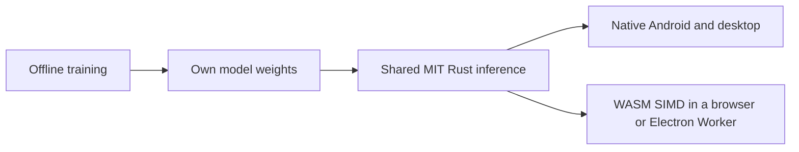

# Portable KithMoot vision runtime

Original MIT Rust inference engine for our experimental neural models. No
third-party crates, vision SDKs, model downloads, network clients or telemetry.
Rust's standard library and platform libraries retain their own notices.

One source implements convolution, interpolation, activations and multiple-face
decoding. ARM64 uses NEON, x86-64 uses SSE2, and the browser build uses WASM
SIMD128. Prepared tensors are reused across frames. A face-only request skips
the expensive foreground head; a matte-only request skips face decoding.
Old outputs from a skipped task are inaccessible.

The mobile v2 graph uses depthwise and pointwise matting layers at the same
input resolution. The original dense v1 graph remains supported for reference
comparisons. Each architecture needs its own trained weights and qualification.

Training stays in Python/PyTorch as an offline development tool. Runtime
weights use a small, versioned, auditable format rather than embedding Python
or a third-party inference engine. These weights are not qualified for calls.



## Build and check

Run from **this directory** so Cargo reads `.cargo/config.toml`. All builds
reuse the same local `target/`; do not set a task-specific `CARGO_TARGET_DIR`.
Rust 1.94.1 was used for the recorded builds.

```sh
cargo test --locked
cargo build --locked --release --lib --example bench
cargo build --locked --release --lib --target wasm32-unknown-unknown
```

For Android ARM64, point `CARGO_TARGET_AARCH64_LINUX_ANDROID_LINKER` to your
NDK's `aarch64-linux-android26-clang`, then build:

```sh
cargo build --locked --release --lib --example bench --target aarch64-linux-android
```

The local cross-build used NDK 27.1.12297006. Android and WASM are documented
[Rust targets](https://doc.rust-lang.org/rustc/platform-support/android.html);
the [bare WASM target](https://doc.rust-lang.org/rustc/platform-support/wasm32-unknown-unknown.html)
requires no WASI host, filesystem, socket or clock imports. The JavaScript host
rejects modules with **any** host imports. It does not fetch anything itself.

From `vision/`, after training an experiment:

```sh
python3 -m kithmoot_vision.export runs/smoke-model/experimental.pt runs/smoke-model/experimental.kvm
PYTHONPATH=. python3 scripts/check-portability.py runtime/target/release/libkithmoot_vision.dylib runs/smoke-model/experimental.pt runs/parity.json
node scripts/check-wasm.mjs runtime/target/wasm32-unknown-unknown/release/kithmoot_vision.wasm runs/parity.json
runtime/target/release/examples/bench runs/smoke-model/experimental.kvm 20 160 96 faces
node scripts/bench-wasm.mjs runtime/target/wasm32-unknown-unknown/release/kithmoot_vision.wasm runs/smoke-model/experimental.kvm 20
```

Use `.so` instead of `.dylib` on Linux. Parity checks cover all combinations
of optional room reference and previous matte, plus decoded face boxes. The
runtime benchmark reports face-only, matte-only and combined paths separately.
[Mobile results](../experiments/2026-10-18-runtime-mobile.json) and
[dense reference results](../experiments/2026-10-18-runtime.json) are initial
Apple M1 development-machine baselines under other build load, not device
qualification. Node's WASM timings are not browser acceptance.

## ABI and model format

[C header](include/kithmoot_vision.h) exposes one owned engine handle. Native
hosts can wrap it through JNI/Node-API. [WASM host](../web/runtime.mjs) wraps
the same functions for a Worker. The [Local Camera Lab](../lab/README.md)
uses this engine on camera/file frames with one request in flight and source
epoch checks. No mobile or Electron native bridge has yet
been integrated into either app's camera path.

- Images are upright, normalised NCHW `f32`. The caller resizes before inference.
  Width and height must be multiples of four, at least 16, with at most 65,536
  pixels and no dimension exceeding 512. Invalid/non-finite inputs refuse output.
- Input kinds: current RGB, optional reference RGB, optional previous alpha.
  Flags explicitly enable reference and temporal evidence each frame.
- Output kinds: foreground alpha, face logits, face geometry and decoded
  `[x, y, width, height]` boxes in normalised coordinates. Decoding supports up
  to 32 faces; no detections, invalid geometry or overflow is unusable rather
  than a silently truncated list. This does not detect confidently missed faces.
- Each handle has one owner and must not be called concurrently. All returned
  views are borrowed and invalidated by input access, resize, run or close.
  The JS host recreates views after memory growth. Copy outputs to retain them.
- A future camera worker must pair each result with the same captured frame,
  source epoch and timestamp. Allow at most one inference frame in flight;
  discard superseded results. Never apply old boxes to newer raw frames.
- Use a Worker rather than blocking the browser renderer. No SharedArrayBuffer
  or WASM threads are required. The native adapter should keep capture buffers
  local and avoid repeated Bitmap/JVM copies. Those adapters remain open.

`KVM1` and `KVM2` contain four magic bytes, a little-endian `u32` parameter
count, then little-endian `f32` values. V1 has 30,086 parameters (120,352 bytes);
v2 has 19,974 (79,904 bytes). Both start with the encoder's three convolutions,
face feature convolution, heat head and box head. V1 ends with three dense
matte convolutions; v2 uses depthwise 40, pointwise 40→24, depthwise 24,
pointwise 24→16, then the alpha head. Each stores OIHW weights then bias;
depthwise weights have one input channel per output channel. Graph changes
require a new format version. Wrong length/count, trailing bytes and non-finite
weights are rejected. `kv_weight_bytes()` gives the maximum allocation size,
not the length of every accepted file. Export retains experimental status;
it cannot qualify a model.

## What remains

The [model/data and acceptance gates](../README.md) remain open. There are no
qualified real-camera weights. Model accuracy, object retention, temporal
stability and actual devices need work independently of engine correctness.
The current CPU kernels are an initial baseline, not a claim of optimal speed.
Use measurements to choose smaller/separable model operators, quantisation or
an optional GPU backend; Rust/WASM alone cannot guarantee a frame rate.

Keep the original MIT [licence](LICENSE) and the installed standard library's
[copyright and dependency notices](third_party/rust-1.94.1/COPYRIGHT-library.html)
with distributed binaries. That upstream file also lists code for targets we
do not build; it does not relicense our sources. Review the actual final linked
artefact and retain applicable platform/runtime notices before distribution.
